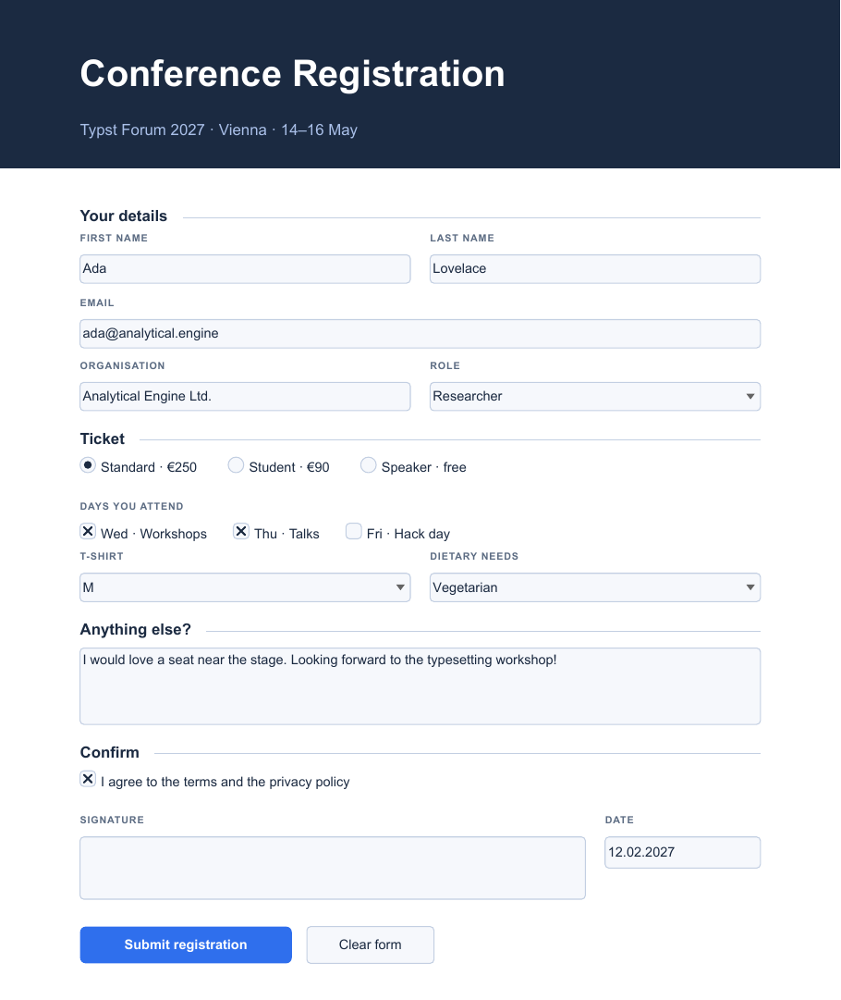

# typst-form

Fillable PDF forms with Typst.



## Quickstart

`typst-form` requires [Typst](https://typst.app) v0.15 or newer.

### Installation

**1. Install the `typst-form` CLI Tool:** Download it from the [releases](https://github.com/yannickbecher/typst-form/releases) and put it on your `PATH`, or build it with Rust:

```bash
cargo install --git https://github.com/yannickbecher/typst-form typst-form
```

**2. Register the Typst Package:** It is bundled with the tool. Run

```bash
typst-form install
```

### Create Your First Form

```typst
#import "@local/typst-form:26.1.0": *

= Registration

Name: #text-field("name", required: true)

Country: #combo-box("country", ("Austria", "Germany", "Switzerland"))

#check-box("agree", label: [I agree to the terms])

#submit-button("send", "https://example.com/form")
```

Compile it and let Typst run `typst-form` afterward:

```bash
typst compile form.typ --open typst-form
```

`form.pdf` is now a fillable form. See [`examples/`](examples) for more complete
forms, each with its ready-made PDF.

## Documentation

**<https://yannickbecher.github.io/typst-form/>**: all fields and options,
validation and calculations, JavaScript, fonts, accessibility, troubleshooting
and limitations.

## Contributing

See [CONTRIBUTING.md](CONTRIBUTING.md).

## License

Licensed under either of [MIT](LICENSE-MIT) or [Apache-2.0](LICENSE-APACHE), at
your option.
