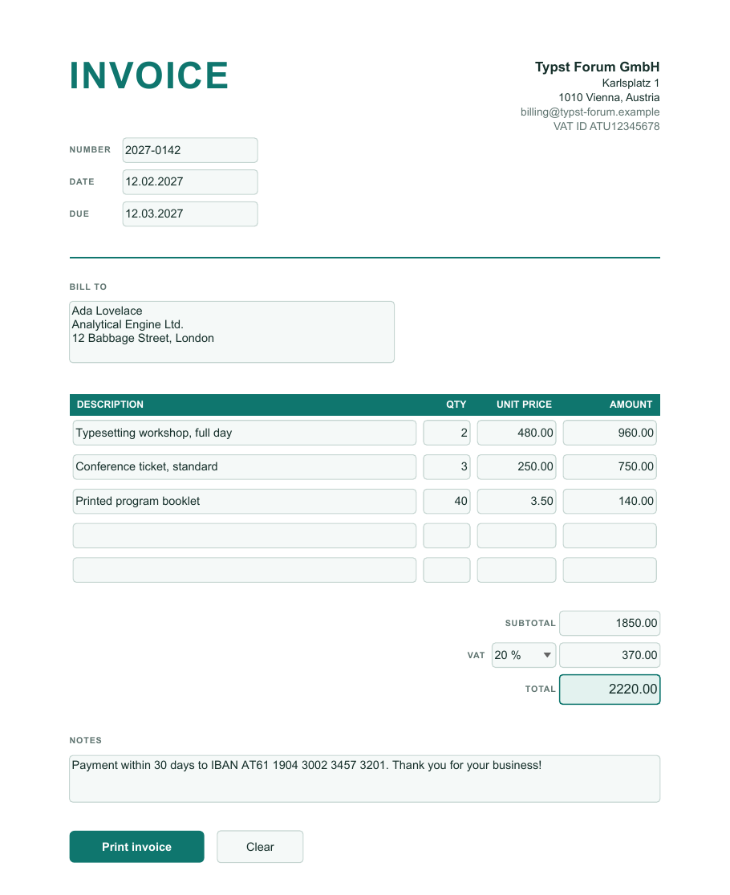

# Examples

All examples live in
[`examples/`](https://github.com/yannickbecher/typst-form/tree/main/examples).
Compile one from the repository root:

```bash
typst compile --root . examples/registration.typ --open typst-form
```

Next to every example is its compiled, fillable PDF (`examples/*.pdf`), so you
can open one right away. In a clone of the repository, `just examples` rebuilds
all of them.

The pictures below were made with `--input demo=true`, which fills in sample
data (supported by the registration, invoice and survey examples). Without it
the forms are empty. To use an example in your own file, import the package
instead of the relative path: `#import "@local/typst-form:26.1.0": *`.

## Registration

Header band, rounded fields, a radio group, checkboxes, dropdowns, a multi-line
text field, a signature and styled buttons.
Source: [`registration.typ`](https://github.com/yannickbecher/typst-form/blob/main/examples/registration.typ)


## Invoice

An invoice that calculates itself: line amounts, subtotal, VAT and total update
while you type, and a button prints it (the calculations need a viewer that
runs JavaScript, see [Viewers](viewers.md)).
Source: [`invoice.typ`](https://github.com/yannickbecher/typst-form/blob/main/examples/invoice.typ)



## Survey

Radio buttons placed freely in a table, a radio group, a dropdown and a free-text
answer.
Source: [`survey.typ`](https://github.com/yannickbecher/typst-form/blob/main/examples/survey.typ)


## More

- [`all-fields.typ`](https://github.com/yannickbecher/typst-form/blob/main/examples/all-fields.typ):
  every field type and the most important options on one page.
- [`javascript-events.typ`](https://github.com/yannickbecher/typst-form/blob/main/examples/javascript-events.typ):
  calculations, formats, validation and your own scripts.
- [`minimal.typ`](https://github.com/yannickbecher/typst-form/blob/main/examples/minimal.typ):
  the smallest possible form.
